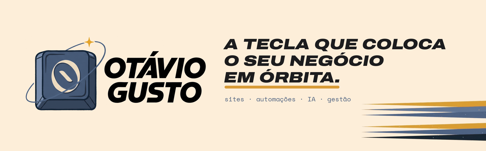
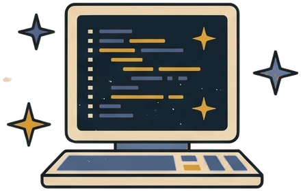
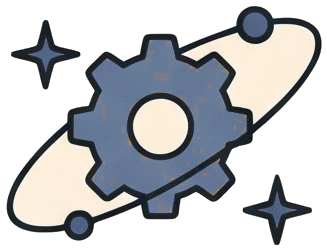
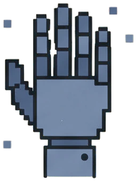
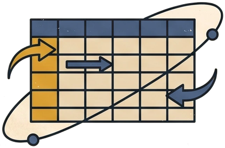
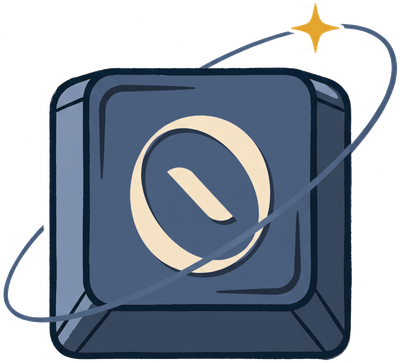

<!-- Banner da marca -->

  

  
  
  <!-- Troque SEU-PERFIL pelo seu usuário do LinkedIn -->
  
  <!-- Troque SEU-EMAIL pelo seu e-mail -->
  

  

## Sobre mim

Sou **Otávio Gusto**, cientista da computação e pós-graduando em Engenharia de Software. Passei mais de quatro anos na área **antifraude do Grupo Santander**, analisando transações de pessoas e empresas e bloqueando movimentações suspeitas antes que virassem golpe.

Hoje atuo na **gestão contábil, financeira e de projetos** de clientes, de pessoas físicas a empresas de transporte. Nesse dia a dia, uno o olhar de negócio à tecnologia: crio **sites, automações e soluções com IA** que deixam processos mais rápidos, seguros e organizados.

## O que eu faço

<table>
  <tr>
    <td align="center" width="25%">
       
      <b>Sites</b> 
      Sites rápidos e bonitos que apresentam e vendem.
    </td>
    <td align="center" width="25%">
       
      <b>Automações</b> 
      Processos que rodam sozinhos e liberam tempo.
    </td>
    <td align="center" width="25%">
       
      <b>Inteligência artificial</b> 
      IA aplicada a planilhas, rotinas e atendimento.
    </td>
    <td align="center" width="25%">
       
      <b>Gestão</b> 
      Finanças, contabilidade e projetos em ordem.
    </td>
  </tr>
</table>

## Trajetória

| Período | O quê |
| :-- | :-- |
| Hoje | **Assistente contábil (MEI)**: contabilidade, finanças de clientes, marketing, design e sites, incluindo o lançamento de uma marca de dermocosméticos |
| 4 anos e 6 meses | **Analista antifraude, Grupo Santander**: análise e bloqueio de transações de risco (PF e PJ) e curso de correspondente bancário |
| Em andamento | **Pós-graduação em Engenharia de Software** |
| Concluído | **Bacharelado em Ciência da Computação** |

## Ferramentas

<!-- Ajuste esta lista para as tecnologias que você realmente usa -->

  
  
  
  
  
  
  
  

## Em números

<!-- Troque otaviogusto pelo seu usuário do GitHub, se for diferente -->

  
  

## Vamos conversar?

Tem um processo que toma tempo demais, uma planilha que ninguém entende ou um negócio que ainda não está na internet? Me chama: a gente encontra a tecla certa.

   
  <b>A tecla que coloca o seu negócio em órbita.</b> 
  <a href="https://otaviogusto.dev">otaviogusto.dev</a>

